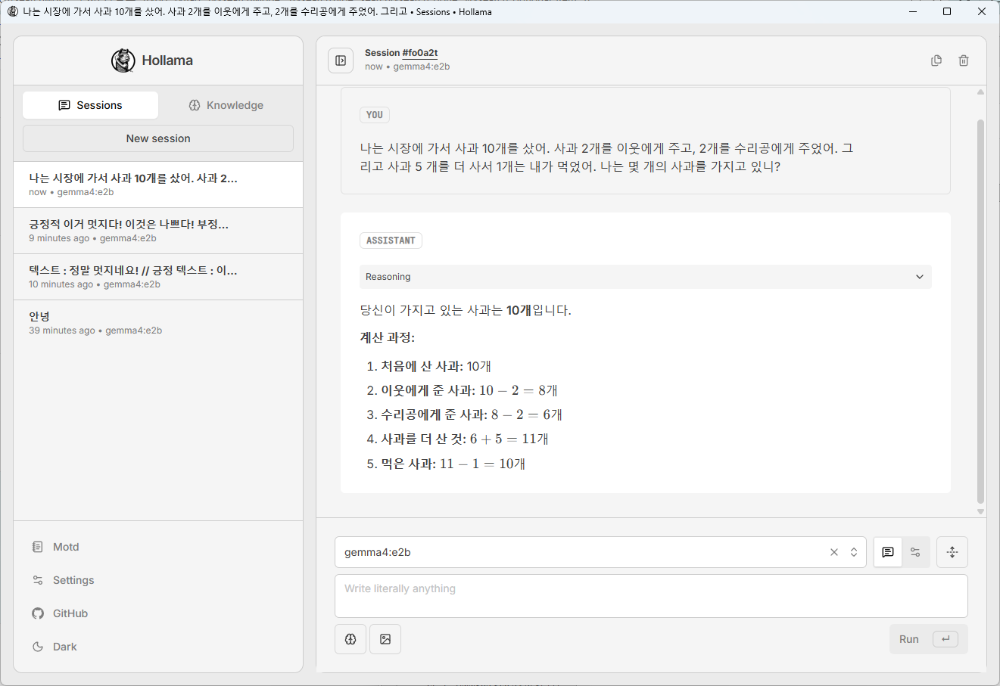

# Ollama + gemma4:e2b 로컬 LLM 테스트

Docker로 Ollama를 띄우고, `gemma4:e2b` 모델을 터미널 / Hollama / 직접 만든 스트리밍 채팅 HTML로 테스트한 수업 정리.

- 날짜: 2026-11-19
- 환경: Windows 11, Docker Desktop, NVIDIA GPU (`--gpus=all`)
- 모델: `gemma4:e2b` (약 5GB)

## 폴더 구조

```
.
├── README.md
├── app.py                       # Flask 프록시 서버 (브라우저 ↔ Ollama)
├── requirements.txt             # flask, requests
├── logs/terminal-log.txt        # 실습 터미널 로그 원본
├── web/index3.html              # Ollama 스트리밍 채팅 프론트 (/api/chat)
└── images/hollama-apple-test.png # Hollama 테스트 화면
```

## 1. Ollama 컨테이너 실행

```bash
docker run -d -it --gpus=all -v ollama:/root/.ollama -p 11434:11434 --name ollama ollama/ollama
```

| 옵션 | 의미 |
|---|---|
| `-d` | 백그라운드 실행 |
| `-it` | 터미널 연결 가능하게 |
| `--gpus=all` | 호스트 GPU 사용 |
| `-v ollama:/root/.ollama` | 모델 파일을 볼륨에 저장 (컨테이너 지워도 유지) |
| `-p 11434:11434` | Ollama API 포트 열기 |

## 2. 컨테이너 접속 + 모델 받기

```bash
docker exec -it ollama /bin/bash
ollama pull gemma4:e2b
ollama run gemma4:e2b
```

> ⚠️ 실수 기록: `docker exec -it ollama/bin/bash` 처럼 **`ollama`와 `/bin/bash` 사이 공백을 빼먹으면**
> `docker exec requires at least 2 arguments` 에러가 난다. (컨테이너 이름 / 실행할 명령어는 공백으로 구분)

## 3. 터미널 테스트 (`ollama run`)

| 입력 | 결과 |
|---|---|
| `안녕` | 한국어 인사로 정상 응답 |
| `텍스트: 휴가는 괜찮을 것 같아요. 감정:` | 긍정적 / 안심 / 평온함 + 설명 (few-shot 형식 감정 분류) |

- 이 모델은 답변 전에 `Thinking...` 구간(추론 과정)을 먼저 출력한다.
- 입력 형식을 `텍스트: ... 감정:` 처럼 주면 분류 작업처럼 이어서 답한다.

## 4. Hollama 테스트

[Hollama](https://github.com/fmaclen/hollama)(Ollama용 웹 UI)에서 서버 `http://localhost:11434`, 모델 `gemma4:e2b`로 연결해서 테스트.

테스트한 세션:
- 긍정/부정 분류 프롬프트
- 텍스트 감정 분류 프롬프트
- 사과 계산 문제 (아래)

**사과 문제**

> 나는 시장에 가서 사과 10개를 샀어. 사과 2개를 이웃에게 주고, 2개를 수리공에게 주었어. 그리고 사과 5개를 더 사서 1개는 내가 먹었어. 나는 몇 개의 사과를 가지고 있니?

모델 답: **10개** (10 → 8 → 6 → 11 → 10). 정답과 일치.



## 5. 스트리밍 채팅 웹 (`web/index3.html`)

- `POST /api/chat` 호출, 응답을 **NDJSON 한 줄씩** 읽어서 화면에 실시간 출력
- 대화 히스토리(`history` 배열)를 매 요청마다 `messages`로 같이 보냄 → 이전 대화 문맥 유지
- Enter = 전송, Shift+Enter = 줄바꿈, Clear = 대화 초기화
- 기본 모델 입력값: `gemma4:e2b`

### Flask 서버 (`app.py`)

브라우저와 Ollama 사이에서 요청을 중계하는 프록시 서버.

- `GET /` : `web/index3.html` 제공
- `POST /api/chat` : 요청(JSON)을 검증한 뒤 Ollama `http://localhost:11434/api/chat`으로 전달하고, 응답을 **NDJSON 스트림 그대로** 브라우저에 흘려보냄
  - `model`, `messages` 검증 (잘못되면 400)
  - `format`, `options`, `tools`, `keep_alive`가 오면 함께 전달
  - Ollama에 연결 실패하면 502 + 안내 메시지

실행 (Ollama 컨테이너가 떠 있어야 함):

```bash
pip install -r requirements.txt
python app.py
# 브라우저에서 http://127.0.0.1:5000 접속
```

## 배운 점

- Ollama는 컨테이너 안에서 모델을 받고, 11434 포트로 API를 제공한다.
- 같은 모델이라도 터미널 / Hollama / 직접 만든 웹으로 붙을 수 있다 (전부 같은 Ollama API 사용).
- 스트리밍은 응답을 한 번에 받지 않고 조각(chunk)으로 받아 이어 붙이는 방식.
